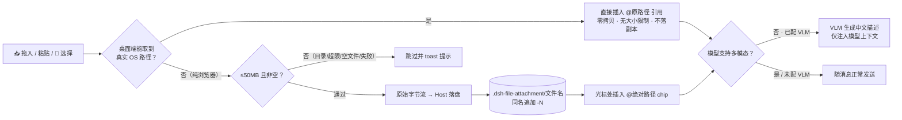
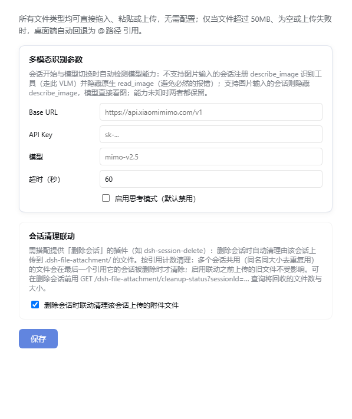
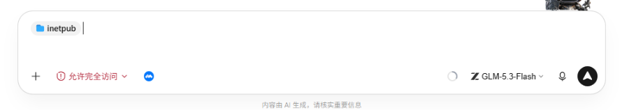
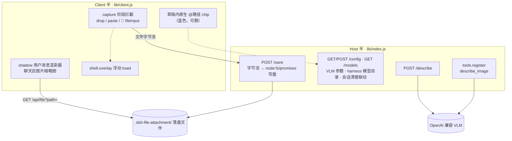

# dsh-files-fallback

<p align="right"><a href="#english">English</a> | 中文</p>

<div align="center">


**文件引用与附件插件 for [DeepSeek Harness (DSH)](https://www.npmjs.com/package/@deepseek-ai/dsh) Web GUI**

拖拽 / `Ctrl+V` 粘贴 / 📎 按钮上传 · `@绝对路径` 引用 · 桌面端兜底引用（目录、超大文件、失败不落空）· 内联缩略图 · VLM 图片识别 · 会话删除联动清理

</div>

> **File reference & attachment plugin for DSH web GUI:** drag, paste, or upload files and images; desktop entries that cannot be uploaded (folders, oversized files, failed transfers) gracefully fall back to `@path` references with zero copy and no size limit.

## 目录

- [亮点](#亮点)
- [快速开始](#快速开始)
- [核心能力](#核心能力)
- [处理流程](#处理流程)
- [界面](#界面)
- [行为一览](#行为一览)
- [存储细节](#存储细节)
- [会话清理联动](#会话清理联动)
- [安装](#安装)
- [架构](#架构)
- [开发说明](#开发说明)
- [English](#english)
- [License](#license)

## 亮点

**桌面端 `@原路径` 零拷贝引用**：在 DSH 桌面壳里，本插件通过 Electron `webUtils` 拿到拖入文件的**真实操作系统路径**，然后**一律直接插入 `@原路径` 引用**——不复制、不上传、不落副本：

- **零拷贝**：文件不读取、不上传、不落盘，直接引用原位置，不产生重复占用磁盘的副本；
- **无大小上限**：几个 GB 的数据集目录、日志文件照样引用；
- **原位置即真相**：文件被移动、改名或删除后，引用它的消息在读取时会明确报「文件不存在」，模型与预览都能感知，而不是悄无声息地展示一份过期副本；
- **文本模型可用**：agent 收到 `@路径` 后可自行按需读取，浏览器半与桌面半行为统一（纯浏览器无路径可用，才上传落盘副本）。

**所有文件类型一律放行**：不再设扩展名白名单，任意文件都可拖入、粘贴或通过 📎 选择上传，无需任何配置。

## 快速开始

```powershell
dsh plugin --profile web add ./dsh-files-fallback
```

安装后重启 web GUI 即生效。

## 核心能力

| 能力 | 说明 |
| :--- | :--- |
| 🔗 **桌面端零拷贝引用** | 桌面壳内拿到真实 OS 路径：**所有拖入的文件与目录一律直接 `@原路径` 引用**（零拷贝、无大小限制、不落副本，原文件被移动/删除后由读取方报「文件不存在」）；纯浏览器才走上传落盘 |
| 📥 **三种入口** | 拖入、`Ctrl+V` 粘贴、接管 dsh 原生 📎 附件按钮（加号右侧、modes 左侧，可多选）；PC 与移动端浏览器均适用 |
| 🗂️ **统一落盘管线** | 任意类型文件与图片同走一条链路，平铺保存到 `<会话工作区>/.dsh-file-attachment/<文件名>`；同名冲突追加 `-N` 绝不覆盖；同名同大小自动去重复用；单文件上限 50MB |
| 🔖 **`@绝对路径` 引用** | 落盘后在光标处插入 chip，文本模型也能「看懂」附件 |
| 🖼️ **双区预览** | 输入框内只有草稿里的原生 `@路径` chip（蓝色）：鼠标悬停出现 `×`，点击即删除该引用（不再额外渲染附件条，避免同一附件重复出现两次）；聊天区图片渲染为可点击放大的缩略图（Lightbox） |
| 🤖 **VLM 识别** | 非多模态模型下自动调用视觉模型生成中文图片描述回填草稿（仅注入模型上下文）——模型从 harness 模型目录下拉选，默认走 harness 自带模型、填了 Base URL + API Key 则走自定义 OpenAI 兼容端点；agent 可主动调用 `describe_image` 工具 |
| 🧹 **会话清理联动** | 搭配 [dsh-session-delete](https://github.com/funny-diodio/dsh-session-delete) 等删除会话插件：删除会话时按引用计数自动清理由该会话上传的落盘附件（设置页开关，默认关闭） |

## 处理流程



## 界面

**演示**：桌面端拖入 → 直接插入 `@原路径` 引用（零拷贝）；纯浏览器拖入/粘贴 → 落盘并插入 `@` 引用。引用一律以草稿内的原生 chip 呈现，不额外渲染附件条。目录在输入框与聊天区均以文件夹图标 chip 呈现。

| 设置页（模型下拉 + 会话清理联动） | 输入框内联文件夹 chip |
| :---: | :---: |
|  |  |

**设置页**（「设置 → 文件附件」）：

| 设置组 | 内容 |
| :--- | :--- |
| **VLM 参数** | 模型从 harness 模型目录下拉选取（按服务商分组，无需手填；目录不可用或勾选「手填」时回退文本框，已保存值不在目录中则保留为「已保存」选项，配置不丢）；Base URL / API Key 留空则走 harness 自带模型、填写则走该 OpenAI 兼容端点；思考模式开关（默认禁用）/ 超时时间（默认 60 秒）；未选模型时不启用图片识别 |
| **会话清理联动** | 删除会话时连带清理该会话上传的落盘附件（默认关闭） |

## 行为一览

| 操作 | 行为 |
| --- | --- |
| 📎 按钮多选 / 拖入 / 粘贴任意类型文件 | 桌面端：一律 `@原路径` 引用（零拷贝）；纯浏览器：字节流 → 落盘 → 光标一次性插入全部 `@` 引用；成功不提示，失败简短 toast |
| 一次多个文件 | 批量处理，一次性插入全部引用；部分失败仅提示「N 个已跳过」 |
| 拖入 / 粘贴图片 | 桌面端：`@原路径` 引用（原图不动）；纯浏览器：同一管线落盘 + 插引用；聊天区可点击放大 |
| 拖入目录 | 桌面端（可取真实路径）：自动插入 `@路径/` 引用（文件夹图标 chip）；纯浏览器：toast 提示「不支持拖入目录」 |
| 单文件 > 50MB / 空文件 | 桌面端：`@原路径` 引用（零拷贝、不受限制）；纯浏览器：跳过并提示 |
| 原文件被移动 / 删除 | 引用它的消息在读取/预览时明确报「文件不存在」，不会展示过期副本 |
| 单条目上传失败 | 桌面端可取真实路径时自动转为 `@路径` 引用，否则提示「文件处理失败」 |
| 当前模型不支持多模态 | 自动调 VLM 生成中文描述回填草稿；agent 可用 `describe_image` 工具 |
| 粘贴纯文本 | 不改写，完全原生行为 |
| 重复拖入同名文件（同一天内） | 追加 `-1`、`-2` 序号，绝不覆盖 |
| 移除已插入的引用 | 鼠标移到输入框里的 `@路径` chip 上，左侧文件图标会变成 `×`（移开恢复图标），点击即精确删除该引用（其他 chip 与文本不受影响）；也可以像普通文本一样把光标顶到 chip 后按退格 |

## 存储细节

- **命名**：`.dsh-file-attachment/<清洗后文件名>`（如 `.dsh-file-attachment/说明.docx`），同名在扩展名前追加 `-N`。
- **去重**：上传前先查重（键 = 文件名 + 文件大小，元数据级判定），命中直接复用已有文件路径、零字节上传；`.dsh-file-attachment/.index.json` 为去重索引（自动维护，删除后自动重建）。
- **根目录** = 当前会话工作区（回退顺序：`session.header.cwd` → `sandboxPolicy.workspaceRoot` → `process.cwd()`），每个项目各自维护自己的 `.dsh-file-attachment/`。
- **跨平台**：保存路径用 `path.join` 自适应分隔符；文件名清洗对 Windows / POSIX 均安全；Host 半经 `node:fs/promises` 直接写字节，无 shell 依赖。

## 会话清理联动

上传的文件默认**永久保留**在工作区 `.dsh-file-attachment/`（不随会话删除而清理）。如果你安装了提供「删除会话」能力的插件（如 [dsh-session-delete](https://github.com/funny-diodio/dsh-session-delete)），可以在「设置 → 文件附件 → 会话清理联动」打开开关，实现**删除会话 → 连带上传产物一起删干净**：

- **触发**：会话被删除后（插件监听 `api-session/removed` 总线事件），自动清理该会话上传到 `.dsh-file-attachment/` 的文件；
- **引用计数**：同名同大小去重复用的文件，多个会话共享同一条目——只有最后一个引用它的会话被删除时才真正删除，不会误伤还在用的文件；
- **向后兼容**：启用联动之前上传的旧文件没有归属记录，永远不会被自动清理，零误伤；
- **记账持久化**：会话 → 文件的引用关系随去重索引写入 `.index.json`，重启 GUI 不丢失；
- **状态查询**：`GET /dsh-file-attachment/cleanup-status?sessionId=<id>` 返回该会话上传的文件数与总字节，可在删除前预览将回收的空间。

## 安装

本仓库是标准 dsh 插件包（声明了 `dsh.bundle.patch`）。`dsh plugin add` 的参数会转发给 profile 目录的 pnpm 执行：

```powershell
# 本地源码安装（改完 lib/*.js 后重启 GUI 即生效）
dsh plugin --profile web add ./dsh-files-fallback
```

安装后自动进入 profile 的 `dsh.profile.bundles`，无需手改 profile `package.json`；升级：`dsh plugin --profile web update dsh-files-fallback`。

## 收录与检索（market listing）

本插件已按官方收录规范准备元数据，可被 [awesome-dsh-plugin](https://github.com/awesome-dsh-plugin/awesome-dsh-plugin)（插件市场与 Discover 页的数据源）与 `plugin_market` 工具检索：

- `package.json` 声明完整 `dsh.bundle` manifest（`patch` + `client`），可用 `dsh plugin add` 安装；
- `description` 中英双语，`keywords` 覆盖 dsh / deepseek-harness / multimodal / vision 等检索词；
- `repository` / `homepage` / `bugs` 指回本仓库（npm 包与仓库互相认领）；
- 仓库 topic 含 `dsh-plugin`；
- `screenshots.json` 声明市场详情页截图（`assets/` 下两张）。

收录条目（PR 到 awesome-dsh-plugin 的 `data/plugins/xinstart-1__dsh-files-fallback.yml`）：

```yaml
url: https://github.com/xinstart-1/dsh-files-fallback
name: xinstart-1/dsh-files-fallback
category: vision
description:
  en: 'File attachments for DSH: drag, paste or upload files and images of any type as @absolute-path references, with a desktop fallback for folders and oversized files, and vision-model image descriptions for non-multimodal models picked from a harness model catalog dropdown.'
  zh: 'DSH 文件附件：拖拽/粘贴/上传任意类型文件，统一落盘并以 @绝对路径 引用；桌面端目录/超大文件自动回退为 @路径 引用；非多模态模型的图片由视觉模型识别生成中文描述，模型从 harness 模型目录下拉选取。'
```

## 架构

```
├── package.json          # dsh.client 声明 + bundle patch 指向
├── cordis.patch.yml      # bundle 补丁：插入本插件行
└── lib/
    ├── index.js          # Host 半：webServer 路由（/save /config /describe）+ describe_image 工具
    └── client.js         # Client 半：document 级 capture drop/paste 监听 + 📎 按钮接管 + @路径 兜底 + 槽组件
```



- **Host 半**：前缀路由 `/dsh-file-attachment`——POST `/save`（流式写盘）、GET/POST `/config`（读写 VLM 参数与会话清理联动；`vlm` 下含 `provider` + `model`，落盘 `~/.dsh/file-attachment.json`）、GET `/models`（拉取 harness 模型目录供设置页下拉选模型）、POST `/describe`（调 VLM 返回中文描述与思考模式配置）；另经 `tools.register` 注册 `describe_image` 工具。响应信封 `{ ok, value | error }`。
- **Client 半**：引用以草稿内原生 `@路径` chip 呈现（不接管 `conversation.input.attachments` 附件条槽，避免同一附件在附件条与草稿里重复出现两次）；shadow 用户消息渲染器（`conversation.chat.node` keyed `user`）把聊天区 `@图片路径` 渲染为缩略图（经宿主 `/api/file?path=` 读取图片）；capture 阶段拦截原生 `fileInput` change 事件接管 📎 按钮，文件进入插件统一管线；`window.__DSH_HOST_PATHS__.pathFor`（Electron `webUtils`）可取到真实路径时插入 `@原路径` 引用（零拷贝）；纯文本粘贴完全原生不改写。
- **通知与浮层**：`shell.overlay` frame-wide 浮动 toast（不参与文档流，4 秒自动消失）；拖入任何文件时 capture 阶段拦截应用自带的图片 DropOverlay（其文案对文档是误导）。

## 开发说明

- `lib/*.js`、`package.json`、`cordis.patch.yml`、`README.md` 均为 UTF-8 无 BOM，编辑时保持原编码。
- 纯 ESM 无构建，不依赖装饰器 / 远程反射。
- VLM 请求发送 `thinking: { type: "enabled"|"disabled" }`（部分兼容 API 忽略扁平 `thinkingType`；默认开启深度思考的模型识别极慢，关闭后明显提速）；超时后明确报错中止而非挂死会话；未配置视觉模型时识别静默跳过，不影响落盘。
- 50MB 上限两侧一致（client 跳过 + host 校验）。
- 目录引用采用 `@路径/` 尾斜杠形式（DSH file-reference 语法），插入时以 `appearance: 'folder'` 渲染原生文件夹图标 chip。

## English

**dsh-files-fallback** is a [DeepSeek Harness (DSH)](https://www.npmjs.com/package/@deepseek-ai/dsh) web GUI plugin for attaching files and images of any type to the chat composer via drag-and-drop, paste, or the native DSH paperclip button.

Key capabilities: on desktop every dropped file is referenced by its **original absolute path** (zero copy, no duplicate disk usage, no size limit; a moved or deleted file makes the reference report "not found"), while pure-browser entry points (paperclip, paste, mobile) upload to a unified `.dsh-file-attachment/` pipeline with all file types accepted, same-name conflict handling and a 50MB guard; references render as native draft `@path` chips only (no separate attachment rail, so one attachment never appears twice), including native folder chips (`@path/` with `appearance: 'folder'`), plus clickable chat thumbnails with a lightbox; optional VLM descriptions for non-multimodal models, with the model picked from the **harness model catalog** dropdown (`provider — modelName`; a saved/off-catalog value stays selectable, and a free-text fallback covers catalog failures) — leave Base URL / API Key empty to use the harness's own LLM, or fill both to use a custom OpenAI-compatible endpoint; and an opt-in **session-cleanup sync** that reference-counts and removes a session's uploaded files when that session is deleted (pairs with session-deletion plugins); works on desktop and mobile browsers.

Install:

```powershell
dsh plugin --profile web add ./dsh-files-fallback
```

For detailed behavior, settings, architecture, and development notes, see the Chinese documentation above.

### Market listing / 收录

Metadata is prepared for the official discovery pipeline ([awesome-dsh-plugin](https://github.com/awesome-dsh-plugin/awesome-dsh-plugin) — the data source behind the in-app plugin market, the Discover tab and the `plugin_market` agent tool): a complete `dsh.bundle` manifest installable via `dsh plugin add`, a bilingual `description`, discovery-friendly `keywords`, `repository`/`homepage`/`bugs` pointing back at this repo, the `dsh-plugin` repo topic, and a `screenshots.json` declaring two marketplace screenshots under `assets/`.

## License

MIT。详见 [LICENSE](LICENSE)。
